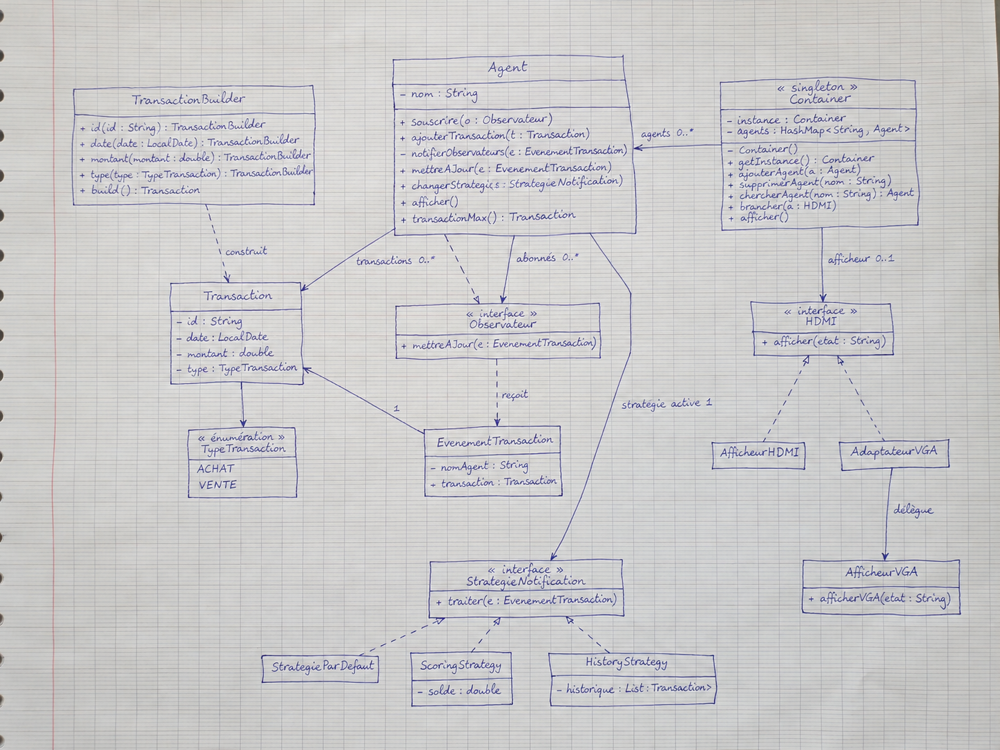

# Examen blanc — Design patterns et programmation orientée aspect

Application Java 21 de gestion d’agents et de leurs transactions. Les questions suivent l’ordre de l’énoncé.

## 1. Diagramme de classes



- **Builder**. `TransactionBuilder` rassemble l’identifiant, la date, le montant et le type, puis crée une `Transaction`.
- **Observer**. `Agent` joue le rôle de sujet et implémente `Observateur`. Un agent a zéro à plusieurs abonnés. Chaque ajout transmet un `EvenementTransaction` qui référence la transaction et contient le nom de l’émetteur.
- **Strategy**. Chaque agent possède une stratégie active. Les trois réalisations traitent la notification par affichage, calcul de solde ou conservation de l’historique.
- **Singleton**. `Container.getInstance()` donne accès à l’instance unique. Sur le diagramme UML, le soulignement indique les membres statiques.
- **Adapter**. `Container` utilise le contrat `HDMI`. `AdaptateurVGA` réalise ce contrat et redirige l’appel vers l’afficheur VGA.

## 2. Transaction et Builder

La transaction est immuable. Les quatre champs doivent être renseignés. Le montant doit être fini et positif ou nul. Un montant nul doit être fourni explicitement. Le type est limité à `ACHAT` ou `VENTE`.

Le scénario construit une vente de 125 et un achat de 40, puis montre les refus pour un montant absent et un montant négatif. [Capture IntelliJ](diagrammes-captures/scenario-transaction.jpg)

## 3. Agent, notifications et stratégies

`A.souscrire(B)` inscrit B comme observateur de A. Chaque observateur reçoit une notification par transaction ajoutée. Le changement de stratégie prend effet à la prochaine notification. La stratégie par défaut affiche l’événement, `ScoringStrategy` ajoute les ventes et soustrait les achats, et `HistoryStrategy` conserve les transactions des événements reçus. Le solde est calculé du point de vue de l’émetteur.

`afficher()` imprime le nom de l’agent et ses transactions. `transactionMax()` compare les montants et renvoie `null` si la collection est vide.

Bob observe Alice. Il reçoit une première notification, passe au scoring (80 − 30 = 50), puis archive la vente suivante. Le registre d’Alice affiche un maximum de 150. [Capture IntelliJ](diagrammes-captures/scenario-agent.jpg)

## 4. Conteneur et afficheurs

Le conteneur indexe ses agents par nom dans une `HashMap<String, Agent>`. Un ajout avec un nom déjà présent remplace l’entrée. Une recherche absente renvoie `null`. L’état envoyé au port HDMI contient les noms triés des agents. L’adaptateur convertit l’appel `HDMI.afficher` en `AfficheurVGA.afficherVGA`.

Le scénario vérifie l’instance unique, retrouve Agence Sud et affiche les deux agences en HDMI. Après suppression d’Agence Nord, l’adaptateur VGA affiche uniquement Agence Sud. [Capture IntelliJ](diagrammes-captures/scenario-conteneur.jpg)

## 5. Patterns supplémentaires proposés

| Pattern | Application possible |
| --- | --- |
| Command | Représenter un ajout ou une suppression comme une commande pour enregistrer les opérations et permettre l’annulation. |
| Repository | Placer le stockage derrière une interface pour utiliser une base de données tout en conservant les opérations métier du conteneur. |
| Factory Method | Créer des afficheurs en fonction de la configuration et centraliser la sélection de l’adaptateur VGA. |

## 6. Aspects techniques

AspectJ tisse les aspects au chargement des classes. Le fichier `src/main/resources/META-INF/aop.xml` enregistre les trois aspects et Maven Exec lance la JVM de l’application avec le javaagent AspectJ et des flux de console en UTF-8.

| Annotation | Comportement vérifié |
| --- | --- |
| `@Log` | Mesure la durée d’exécution avec `System.nanoTime()` et journalise même si la méthode lève une exception. |
| `@Cachable` | Mémorise le maximum par agent, y compris le résultat vide. L’ajout invalide le cache avant la notification pour qu’un observateur qui consulte le maximum voie la nouvelle transaction. Un résultat servi du cache évite l’exécution du calcul et sa journalisation. |
| `@SecuredBy(roles = {...})` | Vérifie la présence d’au moins un rôle requis avant l’appel. `ADMIN` peut gérer les agents et le branchement. `LECTEUR` peut rechercher et afficher. L’authentification vérifie le mot de passe avec PBKDF2 et un sel aléatoire. Le contexte d’authentification est restauré après l’opération. |

Le scénario montre un calcul chronométré du maximum à 75, une seconde lecture depuis le cache, puis un recalcul à 180 après ajout. Il vérifie les refus sans connexion, avec un mauvais mot de passe et avec le rôle LECTEUR pour une écriture. Le rôle ADMIN peut ajouter et retrouver un agent. [Capture IntelliJ](diagrammes-captures/scenario-aspects.jpg)

## Exécuter les scénarios

Avec Java 21, sélectionner dans IntelliJ une configuration versionnée dans `.run` parmi **01 Transaction**, **02 Agent**, **03 Conteneur**, **04 Aspects** et **05 Main complet**. Chaque configuration lance `net.zoungrana.Main` dans une JVM équipée d’AspectJ. Les contrôles intégrés affichent `OK` et arrêtent l’application si un résultat est inattendu. Les comptes utilisés sont des comptes de démonstration locaux.

Depuis PowerShell, compiler et exécuter les quatre scénarios dans le même processus.

```powershell
mvn clean compile exec:exec
```

Ajouter par exemple `'-Dscenario=agent'` pour lancer uniquement le scénario Agent. Les packages `transaction`, `agent`, `observateur`, `strategie`, `conteneur`, `affichage`, `aspect` et `securite` suivent les rôles du modèle.

Les images sont des captures de la fenêtre Run d’IntelliJ IDEA sur Windows. [Capture de l’exécution complète de Main](diagrammes-captures/scenario-main.jpg)
